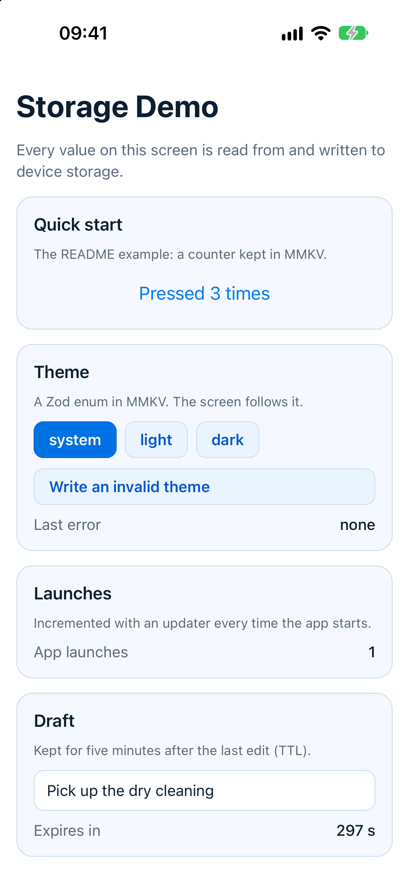
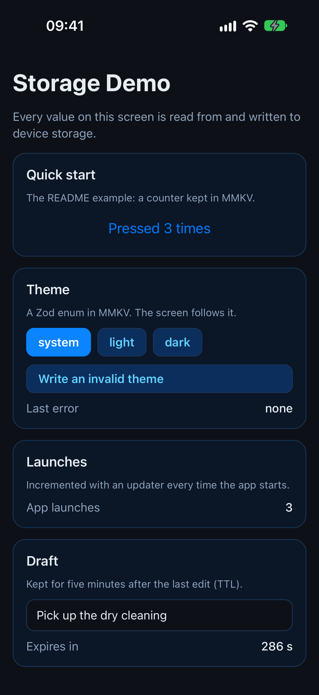
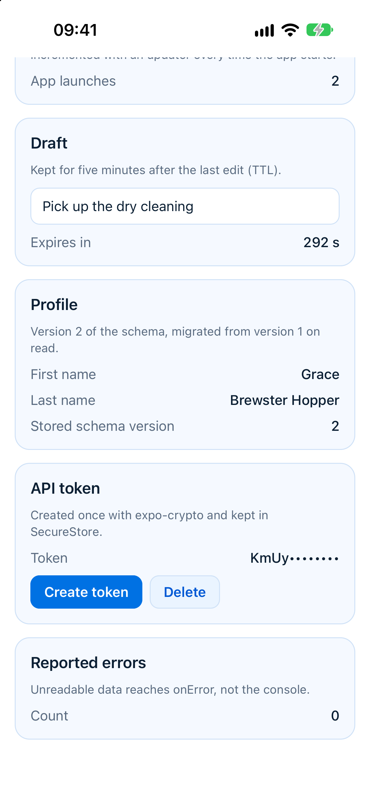
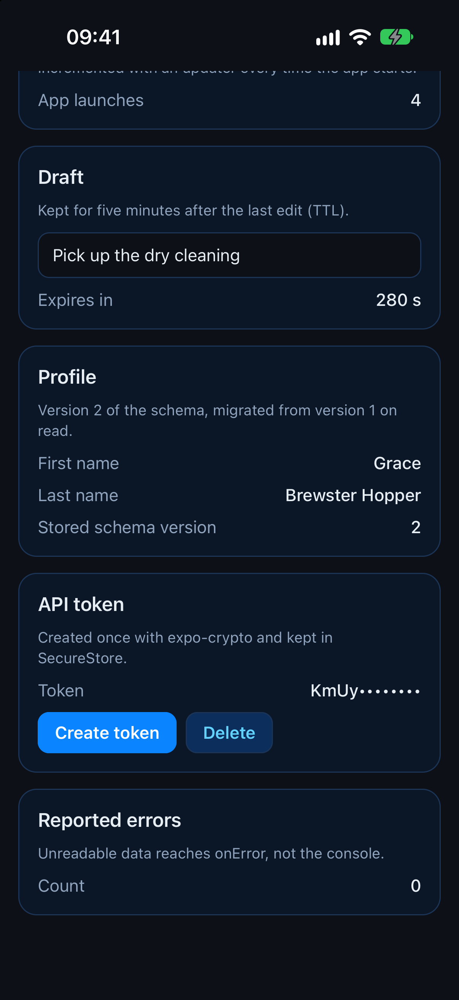

<!-- i18n-source: README.md@a8d8f9cb1fb4fc7f873e2f3c9b86a6212fc6d79b status=reviewed -->
<!-- brand:start -->

<p align="center"><picture><source media="(prefers-color-scheme: dark)" srcset="https://raw.githubusercontent.com/muhittincamdali/ReactNativeStorage/main/.github/brand/banner-dark.svg"><source media="(prefers-color-scheme: light)" srcset="https://raw.githubusercontent.com/muhittincamdali/ReactNativeStorage/main/.github/brand/banner-light.svg"></picture></p>

<!-- lang-selector:start -->
<p align="center"><a href="README.md">English</a> · <a href="README.tr.md">Türkçe</a> · <a href="README.zh-CN.md">简体中文</a> · <a href="README.ja.md">日本語</a> · <a href="README.ko.md">한국어</a> · <a href="README.es.md">Español</a> · <a href="README.de.md">Deutsch</a> · <a href="README.fr.md">Français</a> · <a href="README.pt-BR.md">Português (Brasil)</a> · <a href="README.ru.md">Русский</a></p>
<!-- lang-selector:end -->

<p align="center">
<a href="https://github.com/muhittincamdali/ReactNativeStorage/actions/workflows/ci.yml"></a>
<a href="https://github.com/muhittincamdali/ReactNativeStorage/releases"><picture><source media="(prefers-color-scheme: dark)" srcset="https://raw.githubusercontent.com/muhittincamdali/ReactNativeStorage/main/.github/brand/badge-version-dark.svg"><source media="(prefers-color-scheme: light)" srcset="https://raw.githubusercontent.com/muhittincamdali/ReactNativeStorage/main/.github/brand/badge-version-light.svg"></picture></a>
<a href="https://github.com/muhittincamdali/ReactNativeStorage/blob/main/LICENSE"><picture><source media="(prefers-color-scheme: dark)" srcset="https://raw.githubusercontent.com/muhittincamdali/ReactNativeStorage/main/.github/brand/badge-license-dark.svg"><source media="(prefers-color-scheme: light)" srcset="https://raw.githubusercontent.com/muhittincamdali/ReactNativeStorage/main/.github/brand/badge-license-light.svg"></picture></a>
<a href="https://github.com/muhittincamdali/ReactNativeStorage/blob/main/package.json"><picture><source media="(prefers-color-scheme: dark)" srcset="https://raw.githubusercontent.com/muhittincamdali/ReactNativeStorage/main/.github/brand/badge-framework-dark.svg"><source media="(prefers-color-scheme: light)" srcset="https://raw.githubusercontent.com/muhittincamdali/ReactNativeStorage/main/.github/brand/badge-framework-light.svg"></picture></a>
</p>

<p align="center">
<a href="#schnellstart"><picture><source media="(prefers-color-scheme: dark)" srcset="https://raw.githubusercontent.com/muhittincamdali/ReactNativeStorage/main/.github/brand/button-start-de-dark.svg"><source media="(prefers-color-scheme: light)" srcset="https://raw.githubusercontent.com/muhittincamdali/ReactNativeStorage/main/.github/brand/button-start-de-light.svg"></picture></a>
<a href="https://github.com/muhittincamdali/ReactNativeStorage/blob/main/docs/guides/overview.md"><picture><source media="(prefers-color-scheme: dark)" srcset="https://raw.githubusercontent.com/muhittincamdali/ReactNativeStorage/main/.github/brand/button-docs-de-dark.svg"><source media="(prefers-color-scheme: light)" srcset="https://raw.githubusercontent.com/muhittincamdali/ReactNativeStorage/main/.github/brand/button-docs-de-light.svg"></picture></a>
<a href="https://github.com/muhittincamdali/ReactNativeStorage/tree/main/Examples"><picture><source media="(prefers-color-scheme: dark)" srcset="https://raw.githubusercontent.com/muhittincamdali/ReactNativeStorage/main/.github/brand/button-examples-de-dark.svg"><source media="(prefers-color-scheme: light)" srcset="https://raw.githubusercontent.com/muhittincamdali/ReactNativeStorage/main/.github/brand/button-examples-de-light.svg"></picture></a>
</p>

> Dies ist eine Übersetzung der englischen README. Bei Abweichungen gilt die englische Fassung.

<!-- brand:end -->

Eine TypeScript-Bibliothek, um App-Daten in React-Native- und Expo-Apps auf dem Gerät zu speichern. Du deklarierst jeden Wert einmal, mit einem Namen, einem Standardwert und optional einem Schema, einer Lebensdauer und einer Version; danach liest und schreibst du ihn von überall oder zeigst ihn in einer Komponente mit einem Hook an, der bei jeder Änderung neu rendert. Die Bytes speichert ein Driver deiner Wahl: MMKV, AsyncStorage, SecureStore, `localStorage` oder der Arbeitsspeicher. Sie ist für Apps gedacht, die handgeschriebenen Aufrufen wie `JSON.parse(await AsyncStorage.getItem(...))` entwachsen sind und deren gespeicherte Daten geprüft, typisiert und über App-Versionen hinweg aktualisierbar sein sollen.

## Highlights

- **Typisiert und validiert** — jedes [Standard Schema](https://standardschema.dev) (Zod, Valibot, ArkType) oder ein Type Guard prüft Werte beim Schreiben und beim Lesen; der Typ des Eintrags ergibt sich aus dem Schema.
- **Eine API für fünf Backends** — MMKV (synchron, daher haben Hooks den Wert schon beim ersten Rendern), AsyncStorage, SecureStore (Keychain und Keystore), `localStorage` und Arbeitsspeicher, hinter denselben `get`, `set`, `remove` und `useStorageItem`.
- **Daten, die App-Updates überstehen** — jeder Datensatz trägt eine Schemaversion; Migrations aktualisieren alte Datensätze Schritt für Schritt, ein `legacy`-Reader übernimmt Werte, die vor dieser Bibliothek geschrieben wurden, und Datensätze einer neueren App-Version bleiben unangetastet.
- **Ablauf** — eine Time to Live pro Eintrag oder pro Schreibvorgang; eine Komponente, die einen abgelaufenen Wert zeigt, fällt im Moment des Ablaufs auf den Standardwert zurück.
- **Fehler, die die App nicht abstürzen lassen** — beschädigte oder ungültige gespeicherte Daten liefern den Standardwert und landen in `onError`; Fehlermeldungen nennen den Schlüssel, nie den Wert.
- **Getestet** — 164 Vitest-Tests decken Codec, Validierung, Migrations, TTL, die Reihenfolge gleichzeitiger Schreibvorgänge, jeden Driver, den Hook und die Helfer ab; die Beispiel-App läuft in [`scripts/e2e-ios.sh`](scripts/e2e-ios.sh) auf einem iOS-27-Simulator gegen das echte MMKV und die echte Keychain.

## Schnellstart

**1. Paket hinzufügen**

```sh
npm install github:muhittincamdali/ReactNativeStorage react-native-mmkv react-native-nitro-modules
```

Das Paket wird von GitHub installiert. MMKV ist ein natives Modul: Starte die App mit `npx expo run:ios` oder `npx expo run:android` (ein Development Build), nicht in Expo Go.

**2. Modul importieren**

```tsx
import { createStorage, mmkvDriver } from 'react-native-storage-toolkit';
import { useStorageItem } from 'react-native-storage-toolkit/react';
```

**3. Verwenden**

Diese Komponente aus [`Examples/StorageDemo/src/QuickStart.tsx`](Examples/StorageDemo/src/QuickStart.tsx) zählt Tastendrücke und zeigt den Zähler auch nach einem Neustart der App noch an:

```tsx
import { Button } from 'react-native';
import { createMMKV } from 'react-native-mmkv';
import { createStorage, mmkvDriver } from 'react-native-storage-toolkit';
import { useStorageItem } from 'react-native-storage-toolkit/react';

const storage = createStorage({ driver: mmkvDriver(createMMKV()) });
export const pressCount = storage.item('press-count', { defaultValue: 0 });

export function PressCounter() {
  const [count, setCount] = useStorageItem(pressCount);
  return <Button title={`Pressed ${count} times`} onPress={() => setCount((n) => n + 1)} />;
}
```

## Installation

Das Paket ist nicht in der npm-Registry. Installiere es mit npm, pnpm oder Yarn von GitHub:

```sh
npm install github:muhittincamdali/ReactNativeStorage
```

Es wird mit TypeScript-Quellcode ausgeliefert, den Metro, Expo, Vitest und das `jest-expo`-Preset direkt kompilieren; bei der Installation läuft nichts. Füge dann das Backend hinzu, das du verwenden willst:

| Backend      | Installation                                                    | Driver                                          |
| ------------ | --------------------------------------------------------------- | ----------------------------------------------- |
| MMKV         | `npx expo install react-native-mmkv react-native-nitro-modules` | `mmkvDriver(createMMKV())`                      |
| AsyncStorage | `npx expo install @react-native-async-storage/async-storage`    | `asyncStorageDriver(AsyncStorage)`              |
| SecureStore  | `npx expo install expo-secure-store`                            | `secureStoreDriver(SecureStore, options)`       |
| Web Storage  | nichts                                                          | `webStorageDriver(window.localStorage, window)` |
| Memory       | nichts                                                          | `memoryDriver()`                                |

## Verwendung

Die folgenden Beispiele werden von [`test/readme.test.tsx`](test/readme.test.tsx) kompiliert und ausgeführt, mit dem Memory-Driver anstelle von MMKV.

### Werte mit einem Schema prüfen

Das Schema läuft beim Schreiben und beim Lesen. Das Schreiben eines ungültigen Werts wird abgelehnt und schreibt nichts; das Lesen eines ungültigen gespeicherten Werts liefert den Standardwert und ruft `onError` auf.

```ts
import { z } from 'zod';

const storage = createStorage({
  driver: mmkvDriver(createMMKV()),
  namespace: 'app',
  onError: (error) => console.warn(error.code, error.key), // the key, never the value
});

export const theme = storage.item('theme', {
  schema: z.enum(['system', 'light', 'dark']),
  defaultValue: 'system',
});

await theme.set('dark');
await theme.set('purple'); // rejects: StorageError VALIDATION_FAILED
```

### Einen Wert in einer Komponente anzeigen

`useStorageItem` liefert den Wert, einen Setter, der einen Wert oder eine Update-Funktion annimmt, und den Zustand des Eintrags. Jede Komponente, die den Eintrag anzeigt, rendert nach einem Schreibvorgang neu, egal woher er kam.

```tsx
function ThemePicker() {
  const [value, setValue, { status, error }] = useStorageItem(theme);
  if (status === 'error') return <Text>Could not read the theme: {error?.code}</Text>;
  return <Button title={`Theme: ${value}`} onPress={() => setValue('dark')} />;
}
```

Mit einem asynchronen Driver (AsyncStorage, SecureStore) hat das erste Rendern den Standardwert und `status: 'loading'`.

### Werte ablaufen lassen

```ts
const draft = storage.item('draft', { defaultValue: '', ttl: 5 * 60 * 1000 });
await draft.set('Buy milk'); // gone five minutes later

const otp = storage.item<string>('otp');
await otp.set('482913', { ttl: 30_000 }); // a lifetime for one write
await storage.purgeExpired(); // removes every expired value in the namespace
```

### Die Form gespeicherter Daten ändern

Erhöhe `version` und füge pro Schritt eine Migration hinzu. Alte Datensätze werden beim Lesen aktualisiert und in der neuen Form gespeichert.

```ts
export const profile = storage.item('profile', {
  schema: z.object({ first: z.string(), last: z.string() }),
  version: 2,
  migrations: {
    2: (old) => {
      const [first = '', ...rest] = String((old as { name?: unknown }).name ?? '').split(' ');
      return { first, last: rest.join(' ') };
    },
  },
});
```

### Ein Token in der Keychain aufbewahren

```ts
import * as SecureStore from 'expo-secure-store';

const secure = createStorage({
  driver: secureStoreDriver(SecureStore, {
    keychainAccessible: SecureStore.WHEN_UNLOCKED_THIS_DEVICE_ONLY,
  }),
  namespace: 'auth',
});
export const refreshToken = secure.item('refresh-token', { schema: z.string() });
```

`getOrCreateSecret(item)` erzeugt einmalig einen zufälligen Schlüssel und gibt ihn danach zurück, zum Beispiel um eine MMKV-Instanz zu verschlüsseln; siehe [Tokens und Schlüssel sicher aufbewahren](docs/guides/secure-values.md). Einen gespeicherten Wert, den sie nicht verwenden kann, überschreibt sie nie: Beschädigte, ungültige oder abgelaufene Daten führen zu einem `StorageError` und bleiben unverändert.

### Einen Zustand-Store persistieren

```ts
import { create } from 'zustand';
import { createJSONStorage, persist } from 'zustand/middleware';
import { toStateStorage } from 'react-native-storage-toolkit';

type Cart = { items: string[]; add: (item: string) => void };

export const useCart = create<Cart>()(
  persist(
    (set) => ({ items: [], add: (item) => set((cart) => ({ items: [...cart.items, item] })) }),
    {
      name: 'cart',
      storage: createJSONStorage(() => toStateStorage(storage)),
    },
  ),
);
```

Derselbe Adapter funktioniert mit Jotai, Redux Persist und den Persistern von TanStack Query.

## Demo

[`Examples/StorageDemo`](Examples/StorageDemo) ist eine Expo-SDK-58-App (React Native 0.88), die alle oben genannten Funktionen mit dem echten MMKV und SecureStore nutzt: einen Zähler, ein mit Zod geprüftes Theme, einen Entwurf mit fünf Minuten TTL, ein Profil, das von Version 1 migriert wurde, und ein Token, das mit `expo-crypto` erzeugt und in der Keychain aufbewahrt wird. Die Bildschirme unten stammen aus [`scripts/capture-screenshots.sh`](scripts/capture-screenshots.sh), das die App auf einem iPhone-Simulator installiert und aufnimmt.

| Hell                                                                            | Dunkel                                                                        |
| ------------------------------------------------------------------------------- | ----------------------------------------------------------------------------- |
|        |        |
|  |  |

Probier es selbst aus:

```sh
cd Examples/StorageDemo
npm install
npx expo run:ios      # or: npx expo run:android, npx expo start --web
```

## Dokumentation

API-Referenz und Artikel:

- API-Referenz — jeder Export, mit TypeDoc aus den Quellen erzeugt (`npm run docs` baut sie lokal nach `docs/api`); der [Docs-Workflow](.github/workflows/docs.yml) veröffentlicht sie von `main` aus auf GitHub Pages.
- [Fehlercodes](src/errors.ts) — was jeder `StorageError`-Code bedeutet.

## Anleitungen

- [Von AsyncStorage zu MMKV wechseln](docs/guides/migrating-from-async-storage.md) — die alten Schlüssel einmal kopieren und über `legacy` lesen.
- [Die Form gespeicherter Daten ändern](docs/guides/schemas-and-migrations.md) — Schemas, Versionen und Migrations sowie die Werte, die der Codec erhält.
- [Tokens und Schlüssel sicher aufbewahren](docs/guides/secure-values.md) — SecureStore und ein Verschlüsselungsschlüssel für MMKV.
- [Code testen, der Storage verwendet](docs/guides/testing.md) — der Memory-Driver, eine steuerbare Uhr und Jest-Einstellungen.

## Voraussetzungen

| Toolchain                           | Mindestversion                        |
| ----------------------------------- | ------------------------------------- |
| React                               | 18 (wegen `useSyncExternalStore`)     |
| TypeScript, wenn du Typen prüfst    | 5.0                                   |
| react-native-mmkv, für `mmkvDriver` | 3 (Version 4 braucht React Native 0.76) |
| Node.js, um an diesem Repository zu arbeiten | 22.12                        |

Die Beispiel-App und das End-to-End-Skript werden mit Expo SDK 58, React Native 0.88, Xcode 27 und dem iOS-27-Simulator getestet.

## Architektur

```text
useStorageItem (src/react.ts)          React hook over useSyncExternalStore
        │
StorageItem (src/item.ts)              get / set / remove, snapshots, expiry timers
        │  RecordFormat (src/record.ts)   schema, versions, migrations, legacy, size limit
        │  codec + envelope               {rns, s, e, d} records; Date, Map, Set, bigint, NaN…
        │
Storage (src/storage.ts)               namespace, keys, clear, purgeExpired, onError
        │  KeyStore (src/keyStore.ts)     LRU cache, shared reads, ordered writes, listeners
        │
StorageDriver (src/driver.ts)          mmkv · async-storage · secure-store · web-storage · memory
```

Entscheidungen, die Contributor kennen sollten:

- Drivers passen eine Instanz an, die die App erzeugt hat, und erkennen sie an ihrer Form; deshalb hat das Paket keine Laufzeitabhängigkeiten und unterstützt mehrere Versionen jedes Backends.
- Lesevorgänge werfen bei fehlerhaften Daten nie einen Fehler, sondern nur bei einem ausfallenden Driver; Schreibvorgänge werden abgelehnt und schreiben nichts.
- Der Key Store zeigt einen Schreibvorgang sofort an und sendet Schreibvorgänge auf denselben Schlüssel in der Reihenfolge der Aufrufe; schlägt der neueste Schreibvorgang fehl, kehrt er zum letzten vom Backend bestätigten Wert zurück.
- Jede Grenze wird an der Schnittstelle geprüft: Schlüssellänge und -zeichen, Wertgröße in UTF-8-Bytes, Verschachtelungstiefe, Schemaversionen, TTLs (endlich und im sicheren Ganzzahlbereich) und Timer-Verzögerungen (höchstens 2^31-1 ms).

## Roadmap

Als Nächstes geplant, verfolgt im [Issue-Tracker](https://github.com/muhittincamdali/ReactNativeStorage/issues):

- das Paket in der npm-Registry veröffentlichen;
- einen Lauf des End-to-End-Skripts auf einem Android-Emulator in der CI;
- einen optionalen Schlüsselindex für SecureStore, damit `clear()` beim Abmelden jedes Geheimnis entfernen kann.

## Mitwirken

Beiträge sind willkommen. Lies vor einem Pull Request den [Leitfaden für Beiträge](https://github.com/muhittincamdali/ReactNativeStorage/blob/main/CONTRIBUTING.md) und den [Verhaltenskodex](https://github.com/muhittincamdali/ReactNativeStorage/blob/main/CODE_OF_CONDUCT.md). Sicherheitsprobleme meldest du vertraulich, wie in der [Sicherheitsrichtlinie](https://github.com/muhittincamdali/ReactNativeStorage/blob/main/SECURITY.md) beschrieben.

## Lizenz

Veröffentlicht unter der MIT-Lizenz. Siehe [LICENSE](LICENSE).
